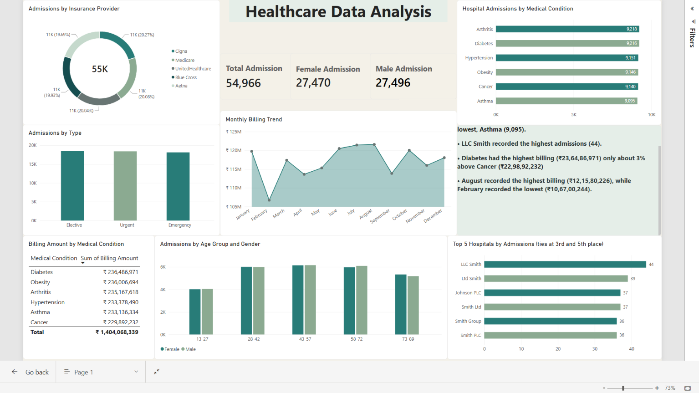

# Healthcare Data Analysis Dashboard (Power BI)

A one-page Power BI dashboard that looks at hospital admissions and billing in a healthcare dataset: which medical conditions, insurers, hospitals and age groups account for admissions, and how billing changes month to month.



## Dataset

- Source: [Healthcare Dataset on Kaggle](https://www.kaggle.com/datasets/prasad22/healthcare-dataset) by Prasad Patil
- Size: 55,500 rows and 15 columns in the original file; **54,966 admissions** after removing 534 exact duplicate rows
- Period covered: admissions from 8 May 2019 to 7 May 2024
- The data is synthetic. Patient and hospital names (for example "LLC Smith") are randomly generated, so the hospital results are only for practising the analysis.
- The source does not state a currency. I show billing amounts with the Rs symbol as an assumption.
- 106 records have a small negative billing amount in the source file. I kept them as they are, so the totals match the source data.

## What I did

1. **Data cleaning (Power Query):**
   - removed 534 exact duplicate rows (55,500 to 54,966)
   - changed the date format to dd-mm-yyyy
   - fixed the capitalisation of the Name column (for example `Bobby JacksOn` became `Bobby Jackson`)
2. **Data model:** a single table (the cleaned healthcare dataset), so no relationships were needed
3. **DAX:** I used DAX for the KPI measures and to create the age-group bins.

   ```
   Total Admission = COUNTROWS(healthcare_dataset)

   Female Admission =
   CALCULATE(
       COUNTROWS('healthcare_dataset'),
       'healthcare_dataset'[Gender] = "Female"
   )

   Male Admission =
   CALCULATE(
       COUNTROWS('healthcare_dataset'),
       'healthcare_dataset'[Gender] = "Male"
   )
   ```

   Age Group is a calculated column:

   ```
   Age Group =
   SWITCH(
       TRUE(),
       'healthcare_dataset'[Age] <= 27, "13-27",
       'healthcare_dataset'[Age] <= 42, "28-42",
       'healthcare_dataset'[Age] <= 57, "43-57",
       'healthcare_dataset'[Age] <= 72, "58-72",
       'healthcare_dataset'[Age] <= 87, "73-87",
       "88-89"
   )
   ```

   Only 33 patients fall in the 88-89 group, so I used Power BI's grouping feature to merge "73-87" and "88-89" into one "73-89" group. The age chart uses that merged field.
4. **Filters:** the Top 5 Hospitals chart uses a Top N filter (top 5 hospitals by number of admissions) set in the Filters pane. Because of ties at 3rd and 5th place, six hospitals are shown.
5. **Dashboard:** built 8 visuals on one page, with data labels, full-number formatting and a Key Findings box.

## What the dashboard shows

- Total, female and male admissions (KPI cards)
- Admissions by insurance provider
- Admissions by admission type (Elective, Urgent, Emergency)
- Hospital admissions by medical condition
- Admissions by age group and gender
- Billing amount by medical condition
- Monthly billing trend
- Top 5 hospitals by admissions (six bars are shown because of ties at 3rd and 5th place)

## Key findings

- There were **54,966 admissions**: 27,470 female and 27,496 male, almost an even split.
- Admissions were spread almost evenly across the six medical conditions. Arthritis had the most (9,218) and Asthma the fewest (9,095), a gap of 123 admissions, about 1.35% of the lowest count. Diabetes was just behind Arthritis at 9,216.
- The five insurance providers each cover about 20% of admissions (19.69% to 20.27%).
- Total billing was **Rs 1,40,40,68,339**. Diabetes had the highest billing (Rs 23,64,86,971), only about 3% above Cancer, the lowest (Rs 22,98,92,232).
- Monthly billing was highest in August (Rs 12,15,80,226) and lowest in February (Rs 10,67,00,244). The trend adds up each calendar month across all years (2019 to 2024). February also has the fewest admissions (4,210, against 4,785 in August) and is the shortest month, so part of its dip is simply fewer days.
- LLC Smith had the most admissions (44), followed by Ltd Smith (39). Johnson PLC and Smith Ltd tied at 37, and Smith Group and Smith PLC tied at 36.

Most of the differences in this dataset are small, so I avoided drawing strong business conclusions from them.

## Files in this repository

| File | What it is |
|---|---|
| `Healthcare_Report.pbix` | the Power BI report (open it in Power BI Desktop) |
| `Healthcare_Report.pdf` | a PDF export of the finished dashboard |
| `dashboard.png` | screenshot of the dashboard |
| `healthcare_dataset.csv` | the original Kaggle dataset (before my cleaning) |

## How to open

Download `Healthcare_Report.pbix` and open it in Power BI Desktop (free, Windows only). You can click the charts to filter the page, and see the data model, DAX and Power Query steps. If you only want to look at the result, open the PDF or the screenshot.

## Tools

Power BI, Power Query, DAX

## Author

Akash Saraswat
[LinkedIn](https://www.linkedin.com/in/akash-saraswat-085533273/) | saraswatakash785@gmail.com
